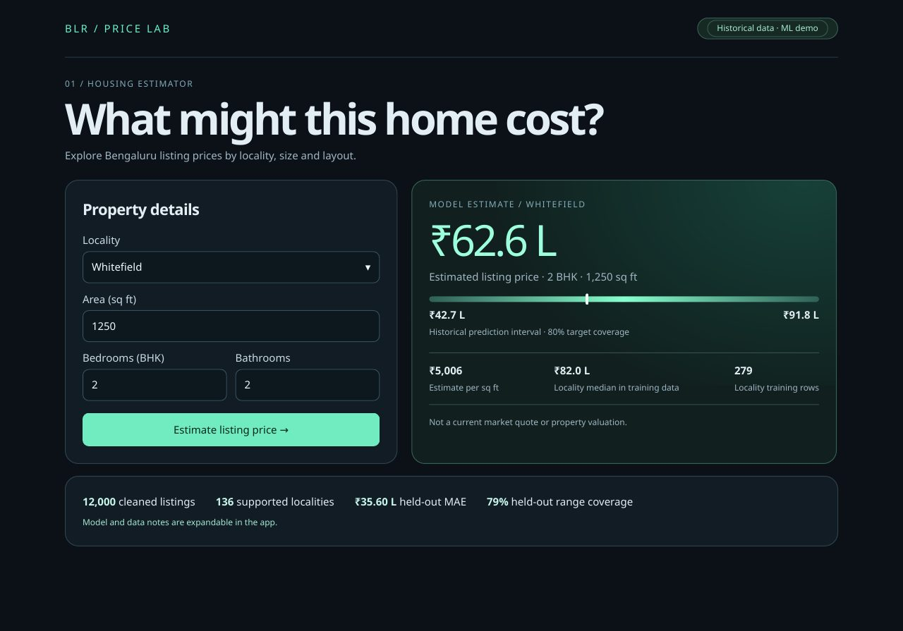

# Bengaluru Price Lab

**A Python GUI for exploring historical Bengaluru housing asking prices.** Pick one of 136 supported localities, enter area, bedrooms and bathrooms, and see an estimate in Indian rupees, a calibrated range, a per-square-foot figure, and historical training context. This is an AI-assisted portfolio project, not a commercial valuation.



[Mobile layout preview](gui-mobile.jpg). These previews were rendered from the app’s HTML and real model output, with form fields rendered for display. They are not live browser screenshots.

## Install and run

Requires Python 3.11 or 3.12. Tested with Python 3.12.

```powershell
git clone https://github.com/vivek1432ps/bengaluru-price-lab.git
cd bengaluru-price-lab
py -3.12 -m venv .venv
.\.venv\Scripts\python.exe -m pip install -r requirements.txt
.\.venv\Scripts\python.exe model.py
.\.venv\Scripts\python.exe app.py
```

Open **http://127.0.0.1:8000**. No API keys or network calls are required after dependency installation. On macOS/Linux, use `python3 -m venv .venv` and substitute `.venv/bin/python` for the Windows executable. Run `python -m unittest -v` with the environment's Python after training.

## Evaluation

Three regressors were compared on a selection split. The selected model was refit on training + selection data, calibrated on separate data, and evaluated on a reserved 2,344-row test split. Exact matches of the four input fields were grouped to avoid splitting them across datasets.

| Model | Held-out MAE | Held-out RMSE | Held-out R² |
|---|---:|---:|---:|
| Global median | ₹66.68 lakh | ₹156.45 lakh | −0.081 |
| Ridge | ₹47.50 lakh | ₹240.20 lakh | −1.548 |
| **Gradient boosting** | **₹35.60 lakh** | **₹90.88 lakh** | **0.635** |

The interval targeted 80% coverage using calibration residuals in log-price space; observed overall held-out coverage was **79%**. This is a historical benchmark, not a guarantee for any locality or present-day market. Results are broad and error is material. No time-based evaluation is possible from the available reliable fields. See [full evaluation](evaluation.json).

## Data and limitations

Source: Amitabha Chakraborty's [Bengaluru House price data](https://www.kaggle.com/datasets/amitabhajoy/bengaluru-house-price-data), listed as CC0. The included [cleaned dataset](data/listings.csv.gz) was derived from [the DPhi CSV mirror](https://raw.githubusercontent.com/dphi-official/Datasets/master/Bengaluru_House_Data.csv) (original SHA-256 `23ddf71be7d79a259b62e125b9d56cb531f9d051b0da650c0fe7cc82365a1015`). The published columns are normalized locality, area, bedroom count, bathroom count and asking price in lakhs. Reproduce cleaning with `python model.py --prepare path/to/Bengaluru_House_Data.csv`.

This dataset contains historical asking prices, not verified transactions. Area definitions vary and some rows are not apartments. Ambiguous area strings, impossible inputs and duplicates were removed; rare locations are not offered in the GUI. Use this to explore a modeling workflow, not as a current quote, transaction recommendation or appraisal.
